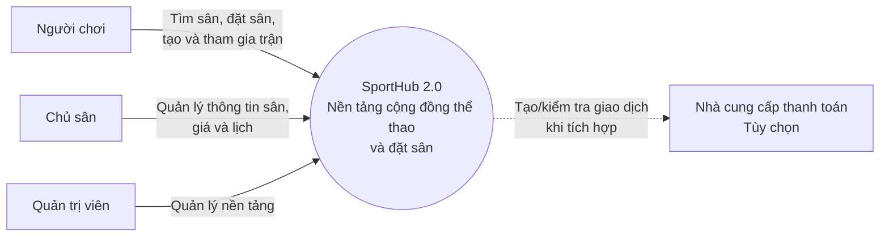
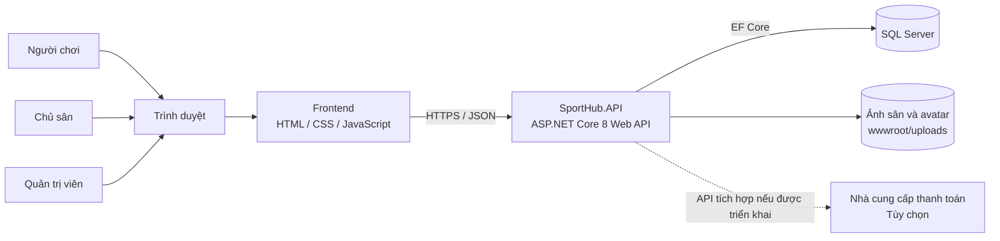

# SportHub 2.0 – C4 Context & Container

Sơ đồ thể hiện các thành phần dự kiến theo kiến trúc trong tài liệu đề bài. Tích hợp cổng thanh toán là hệ thống ngoài tùy chọn, chưa phải cam kết triển khai.

## Context

## Container

## Ranh giới trách nhiệm API

- `AuthController`: đăng ký/đăng nhập; xác thực JWT và phân quyền được cấu hình trong ASP.NET Core.
- `FieldController`: thông tin sân và tìm kiếm/lọc.
- `BookingController`: tạo, truy vấn và cập nhật booking; xử lý xung đột/giữ chỗ ở tầng nghiệp vụ.
- `MatchController`: trận giao lưu/thách đấu, tham gia trận và kết quả/xếp hạng theo phạm vi đã chọn.
- `Services`: nghiệp vụ; `Repositories`/EF Core và `SportHubDbContext`: truy cập SQL Server.

Sơ đồ là kiến trúc mục tiêu, không khẳng định các container đã được triển khai hoặc tích hợp ngoài đã hoạt động.
